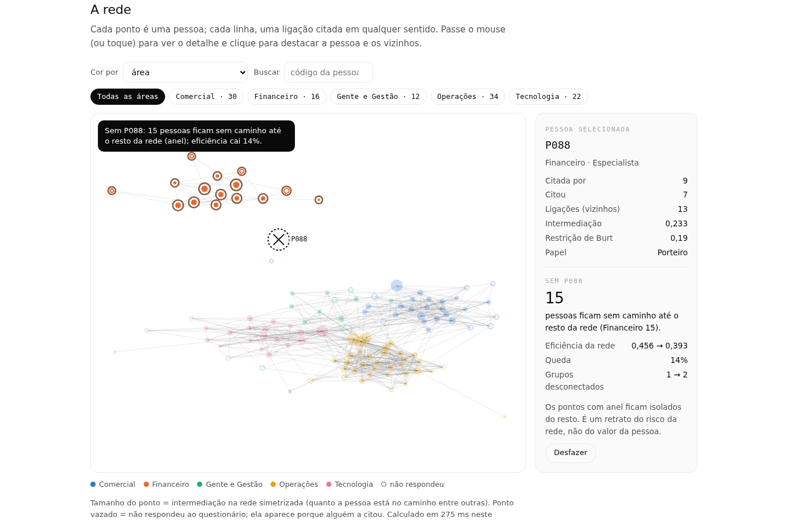
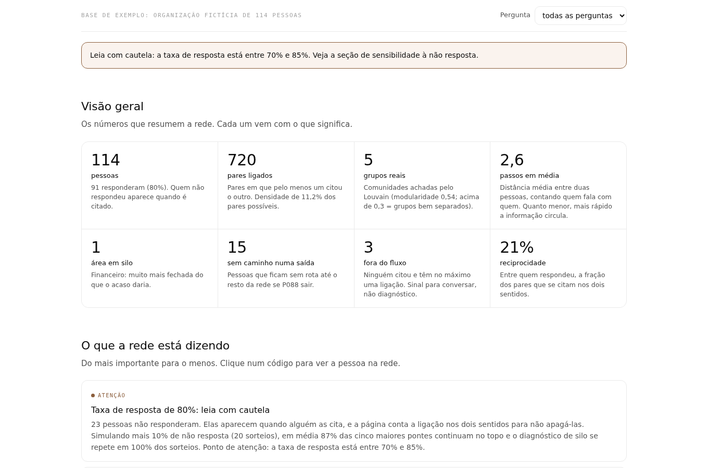
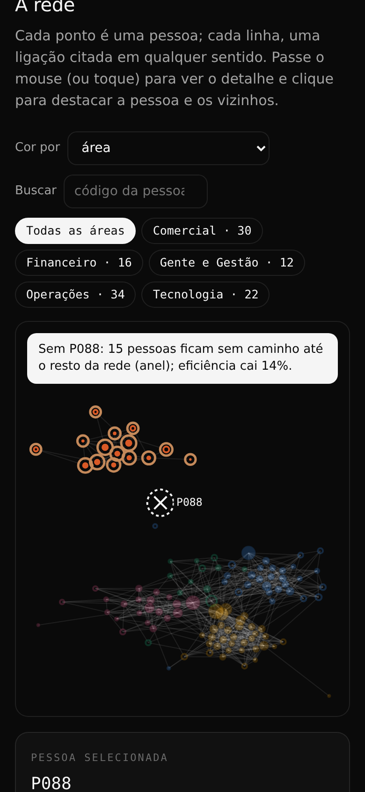

# ONA de bolso

Análise de rede organizacional (ONA) a partir de um questionário simples e duas planilhas.
Mostra quem conecta as áreas, onde há silo de verdade e o que acontece com a rede se uma pessoa sair.
Tudo é calculado no navegador de quem usa: nenhuma tabela vai para servidor.



## O problema

O organograma diz quem responde a quem. Ele não diz por onde a informação passa. Quando um projeto trava entre duas áreas, ou quando sai uma pessoa e "de repente" ninguém mais sabe resolver nada, quase sempre o motivo está na rede informal.

ONA (Organizational Network Analysis) mede essa rede. As ferramentas comerciais custam caro e pedem integração com e-mail e agenda. Para a maior parte das perguntas de um gestor, basta um questionário de nomeação de 2 a 4 perguntas, como "com quem você trocou informação importante nas últimas 4 semanas?".

## O que a ferramenta faz

1. Lê duas tabelas: `pessoas.csv` (quem foi convidado, área, gestor, se respondeu) e `ligacoes.csv` (quem citou quem, em qual pergunta). Também aceita um `.xlsx` com as duas abas.
2. Calcula as métricas no navegador e escreve os achados em português de gestor, do mais importante para o menos.
3. Desenha a rede (até 500 pessoas), com filtro por área, destaque de uma pessoa e dos vizinhos e a simulação "e se essa pessoa sair?".
4. Exporta as métricas por pessoa em CSV, para levar ao Power BI ou ao Excel.

<p>


</p>

| Pergunta de gestor | Como a ferramenta responde |
|---|---|
| A rede depende de alguém? | Tira, uma de cada vez, as 10 pessoas com maior intermediação e mede quem perde o caminho até o resto e quanto cai a eficiência da rede |
| Que área virou silo? | Índice E-I de cada área comparado com o esperado ao acaso. Só é silo a área muito abaixo do acaso, não toda área que conversa mais com o próprio time |
| Por onde a informação entra e sai de cada área? | Papéis de corretagem de Gould e Fernandez: porteiro, representante, consultor, ligação e coordenador |
| Quem conecta grupos que não se falam? | Intermediação e restrição de Burt (buracos estruturais) |
| Os grupos reais batem com o organograma? | Comunidades (Louvain, 20 execuções, com checagem de estabilidade) cruzadas com as áreas |
| O gestor está no fluxo do time? | Fração do time com ligação direta com o gestor |
| Dá para confiar no resultado? | Taxa de resposta, simulação de mais não resposta e regra de leitura: abaixo de 70% de resposta, o relatório não conclui sobre pontes e isolados |

## Como usar

**Sem instalar nada:** baixe `dist/ona-de-bolso.html` e abra com duplo clique. Clique em "Usar a base de exemplo" ou solte as suas duas tabelas. A página não faz nenhuma requisição externa, então funciona até sem internet.

**Modelos de planilha:** `questionario/modelo-ona.xlsx` (abas `pessoas`, `ligacoes` e `instrucoes`) ou `questionario/modelo-pessoas.csv` e `questionario/modelo-ligacoes.csv`. A própria página também baixa os modelos.

### Com Google Forms ou Microsoft Forms

O questionário completo, com texto de convite e cuidados de LGPD, está em [`questionario/questionario-ona.md`](questionario/questionario-ona.md).

1. **Monte a tabela de pessoas antes do formulário.** Uma linha por pessoa convidada, com um código no lugar do nome (`A001`, `A002`...), a área, o gestor e a unidade. Ela vem do cadastro do RH, não do formulário.
2. **Crie o formulário.** Primeira pergunta: "Seu código" (lista suspensa com os códigos ou nomes acompanhados do código). Depois, uma pergunta de caixas de seleção para cada tipo de ligação (`informacao`, `ajuda`...). Em cada opção, coloque o nome e o código entre parênteses: `Ana Souza (A002)`. Com muitas pessoas, divida as opções por área em seções.
   - Google Forms: tipo "Caixas de seleção"; em "Validação de resposta", limite a "No máximo 10".
   - Microsoft Forms: tipo "Escolha" com "Várias respostas" ligado.
3. **Exporte as respostas.** Google Forms: aba Respostas, "Link para o Planilhas", depois Arquivo > Fazer download > CSV. Microsoft Forms: Respostas, "Abrir no Excel" (baixa um `.xlsx`).
4. **Converta para a tabela de ligações.** O conversor acha os códigos dentro das respostas, aceita vírgula (Google) e ponto e vírgula (Microsoft) e marca quem respondeu:

```bash
python3 src/converter_forms.py respostas.csv --pessoas pessoas.csv \
    --quem "Seu código" \
    --pergunta informacao="Nas últimas 4 semanas, com quem" \
    --pergunta ajuda="Quando você trava" \
    --saida ligacoes.csv --marcar-respondeu pessoas.csv
```

   O texto depois de `=` é o começo do título da coluna no arquivo exportado. Funciona com `.csv` e `.xlsx` e só usa a biblioteca padrão do Python.
5. **Solte `pessoas.csv` e `ligacoes.csv` na página.**

Quem preferir não rodar Python pode montar `ligacoes.csv` à mão numa planilha: uma linha por nome citado, com `origem_id` (quem respondeu), `destino_id` (quem foi citado), `tipo` (a pergunta) e `peso` (frequência de 1 a 5, opcional).

## Métodos

O motor (`web/ona-motor.js`) é JavaScript sem dependências, escrito para este projeto. Roda igual no navegador e no Node. Cada algoritmo tem teste numa rede pequena com resposta conhecida e teste na base sintética com estrutura plantada.

- **Duas redes.** Citações recebidas, reciprocidade e papéis de corretagem usam a rede dirigida (quem cita quem). Intermediação, comunidades, E-I, restrição de Burt e a simulação de saída usam a rede simetrizada: há ligação se um dos dois citou o outro. Informação corre nos dois sentidos, e quem não respondeu (que não cita ninguém) continua podendo aparecer como ponte. Na base de exemplo, a pessoa P105 não respondeu e é citada por quatro áreas: na rede dirigida a intermediação dela é zero; na simetrizada, ela é a 7ª maior.
- **Intermediação:** algoritmo de Brandes (2001), normalizada de 0 a 1.
- **Comunidades:** Louvain (Blondel et al., 2008) rodado 20 vezes com sementes diferentes. Fica a divisão de maior modularidade. Depois, toda comunidade com pedaços sem ligação entre si é separada, a garantia mínima que motivou o algoritmo Leiden (Traag, Waltman e van Eck, 2019); separar nunca reduz a modularidade. A estabilidade é o índice de Rand ajustado (Hubert e Arabie, 1985) médio entre a divisão escolhida e as outras execuções.
- **Índice E-I com linha de base:** E-I de Krackhardt e Stern (1988) por área, comparado com o E-I esperado ao embaralhar as áreas entre as pessoas 1.000 vezes, mantendo o tamanho de cada área e a rede. Silo = E-I abaixo do esperado com p < 0,01 e menos de 25% das ligações externas que a área teria ao acaso.
- **Papéis de corretagem:** Gould e Fernandez (1989), com a área como grupo. A informação corre de quem é citado para quem cita ("busco informação com").
- **Restrição e tamanho efetivo:** Burt (1992; 2004), na rede simetrizada com pesos.
- **E se sair:** remove a pessoa e mede componentes, quem perde o caminho até a maior parte da rede e a eficiência global (Latora e Marchiori, 2001).
- **Sensibilidade à não resposta:** compara a rede dirigida com a simetrizada e repete as contas apagando as citações de mais 10% de quem respondeu (20 sorteios), na linha de Borgatti, Carley e Krackhardt (2006) e Kossinets (2006).
- **Núcleo:** k-core (Seidman, 1983), como leitura simples de núcleo e periferia.
- **Reprodutível:** gerador pseudoaleatório mulberry32 com semente fixa. O mesmo arquivo dá sempre o mesmo resultado, e há teste para isso.

Leitura de fundo para quem vai usar com gestores: Cross e Parker (2004).

## Resultado na base de exemplo

A base de exemplo é uma organização fictícia de 114 pessoas em 5 áreas, gerada por `src/gerar_base.py` com semente fixa. O gerador planta o que os testes conferem:

| Plantado | O que a ferramenta achou |
|---|---|
| Financeiro em silo, ligado ao resto por uma pessoa (P088) | Financeiro é a única área em silo: E-I de -0,89 contra +0,86 esperado ao acaso (6% das ligações externas esperadas). As outras quatro também conversam mais para dentro do que o acaso, mas ficam entre 28% e 68% |
| P088 como porteiro: busca informação fora e repassa ao time | Papel de porteiro, responsável por 100% das entradas de informação no Financeiro |
| P088 como ponto único de falha | Sem P088, 15 pessoas ficam sem caminho até o resto da rede e a eficiência cai 14% |
| Duas pontes (P036 e P069) | Entre as 5 maiores intermediações e com as duas menores restrições de Burt entre quem tem 4 ligações ou mais (0,065 e 0,066) |
| Uma ponte que não respondeu (P105) | Intermediação zero na rede dirigida e 7ª maior na simetrizada |
| Gestor do Comercial fora do fluxo | 0 de 29 pessoas do time ligadas a ele |
| 3 isolados e 20% de não resposta | Os 3 aparecem; taxa de 80% gera o aviso "leia com cautela" |

Comunidades: 5 grupos, modularidade 0,54, estabilidade de 0,91 entre as 20 execuções. Na simulação com mais 10% de não resposta, 87% das cinco maiores pontes continuam no topo e o silo se repete em todos os sorteios. O cálculo completo, com 1.000 permutações e 20 sorteios, leva de 0,3 a 0,4 s no Raspberry Pi 5.

```bash
python3 src/gerar_base.py        # base de exemplo em dados/exemplo/
node testes/teste_motor.js       # 43 testes do motor
python3 testes/teste_converter.py
python3 src/montar_pagina.py     # gera dist/ona-de-bolso.html
```

Os testes rodam a cada push no GitHub Actions.

## Estrutura

```
questionario/   texto do questionário, cuidados de LGPD e modelos de planilha
src/            gerador da base sintética, conversor de Forms e montagem da página
web/            motor (ona-motor.js), interface (ona-ui.js) e página (ona.html)
dist/           a página num arquivo só, com a base de exemplo embutida
dados/exemplo/  base sintética, gabarito do que foi plantado e resultado do motor
testes/         testes do motor e do conversor
docs/           documento do projeto e histórico
```

## Limitações

- Questionário de nomeação mede a percepção de quem responde, num momento. Não é registro de interação.
- Não resposta fura a rede justamente nas ligações que faltam. A rede simetrizada recupera parte (quem é citado aparece), mas ligações entre duas pessoas que não responderam não existem na base. Por isso a regra dos 70%.
- Os papéis de corretagem dependem do sentido da citação e, portanto, de quem respondeu. Quem não respondeu não aparece como porteiro nem como representante.
- O limiar de silo (25% das ligações externas esperadas) é uma escolha de leitura, documentada e fixa. Não é um valor universal.
- O refinamento de comunidades separa pedaços desconectados, mas não é o algoritmo Leiden completo.
- O desenho da rede usa layout de força O(n²) e fica limitado a 500 pessoas. Acima disso, a página mostra só as métricas.
- Pesos (frequência de 1 a 5) entram nas comunidades e na restrição de Burt. Intermediação e distâncias ignoram o peso.

## Ética e LGPD

- **Finalidade e transparência.** O convite diz para que serve a pesquisa e o que não vai acontecer com as respostas. Alinhe base legal, finalidade, prazo de guarda e quem vê o resultado com o jurídico e o encarregado de dados (DPO) antes de enviar.
- **Consentimento informado e participação voluntária.** Ninguém deve ser cobrado individualmente por não responder.
- **Uso agregado.** Resultados por área só aparecem com 5 pessoas ou mais. A tabela por pessoa fica escondida por padrão.
- **Diagnóstico de rede, não avaliação de pessoa.** Intermediação alta não é desempenho alto; isolamento não é problema de comportamento. Nenhuma métrica daqui deve entrar em avaliação, promoção ou desligamento.
- **Pseudonimização.** Use códigos no lugar de nomes. A página calcula tudo localmente e não envia dados para lugar nenhum.

## O que aprendi

> Rascunho para o Gleisson revisar e reescrever na voz dele.

- Rede dirigida esconde exatamente quem não respondeu. Na primeira versão, a intermediação usava só o sentido citado, e uma pessoa citada por quatro áreas aparecia com intermediação zero porque não tinha preenchido o questionário. Simetrizar a rede para as medidas de fluxo resolveu, e virou teste.
- E-I sem linha de base chama tudo de silo. Na base de exemplo, as cinco áreas têm mais ligações internas do que o acaso daria. Comparar com o esperado mostrou que só uma está fora do padrão (6% das ligações externas esperadas, contra 28% a 68% das outras).
- Louvain não dá sempre a mesma resposta. Com 20 sementes, a modularidade variou de 0,534 a 0,540 e a concordância média entre as divisões ficou em 0,91. Rodar várias vezes e mostrar a estabilidade é mais honesto do que apresentar uma divisão como se fosse a única.
- O gerador pseudoaleatório da primeira versão estava errado sem dar erro: a conta passava do limite de precisão do JavaScript e a sequência divergia do esperado já no segundo número. Trocar por mulberry32 e testar contra a sequência de referência evitou surpresa.
- O insight mais útil para gestor não é "quem é a ponte", e sim "o que acontece se ela sair". Medir a saída (15 pessoas sem caminho, eficiência 14% menor) transforma uma métrica abstrata em risco de dependência que dá para discutir numa reunião.
- Planejar o gerador sintético junto com os testes obriga a dizer, antes de calcular, o que a ferramenta deveria encontrar.

## Referências

- Blondel, V. D., Guillaume, J.-L., Lambiotte, R., & Lefebvre, E. (2008). Fast unfolding of communities in large networks. *Journal of Statistical Mechanics*, P10008.
- Borgatti, S. P., Carley, K. M., & Krackhardt, D. (2006). On the robustness of centrality measures under conditions of imperfect data. *Social Networks*, 28(2), 124–136.
- Brandes, U. (2001). A faster algorithm for betweenness centrality. *Journal of Mathematical Sociology*, 25(2), 163–177.
- Burt, R. S. (1992). *Structural Holes: The Social Structure of Competition*. Harvard University Press.
- Burt, R. S. (2004). Structural holes and good ideas. *American Journal of Sociology*, 110(2), 349–399.
- Cross, R., & Parker, A. (2004). *The Hidden Power of Social Networks*. Harvard Business School Press.
- Gould, R. V., & Fernandez, R. M. (1989). Structures of mediation: A formal approach to brokerage in transaction networks. *Sociological Methodology*, 19, 89–126.
- Hubert, L., & Arabie, P. (1985). Comparing partitions. *Journal of Classification*, 2, 193–218.
- Kossinets, G. (2006). Effects of missing data in social networks. *Social Networks*, 28(3), 247–268.
- Krackhardt, D., & Stern, R. N. (1988). Informal networks and organizational crises: An experimental simulation. *Social Psychology Quarterly*, 51(2), 123–140.
- Latora, V., & Marchiori, M. (2001). Efficient behavior of small-world networks. *Physical Review Letters*, 87(19), 198701.
- Seidman, S. B. (1983). Network structure and minimum degree. *Social Networks*, 5(3), 269–287.
- Traag, V. A., Waltman, L., & van Eck, N. J. (2019). From Louvain to Leiden: guaranteeing well-connected communities. *Scientific Reports*, 9, 5233.

## Licença

MIT. Veja [LICENSE](LICENSE). Os dados de exemplo são sintéticos; nenhum dado de empregador foi usado.

## Autor

**Gleisson Bispo**, Gerente de People Analytics. Escrevo sobre dados de pessoas, Data Science e IA aplicada a RH.

- Site: [gleissonbispo.com.br](https://gleissonbispo.com.br) (projetos, artigos, radar de notícias e vagas de People Analytics)
- LinkedIn: [linkedin.com/in/gleissonbispo](https://www.linkedin.com/in/gleissonbispo)
- Newsletter: [People Analytics LAB](https://www.linkedin.com/newsletters/people-analytics-lab-7423156507271368704), no LinkedIn
- GitHub: [@gleissonbispo](https://github.com/gleissonbispo)
