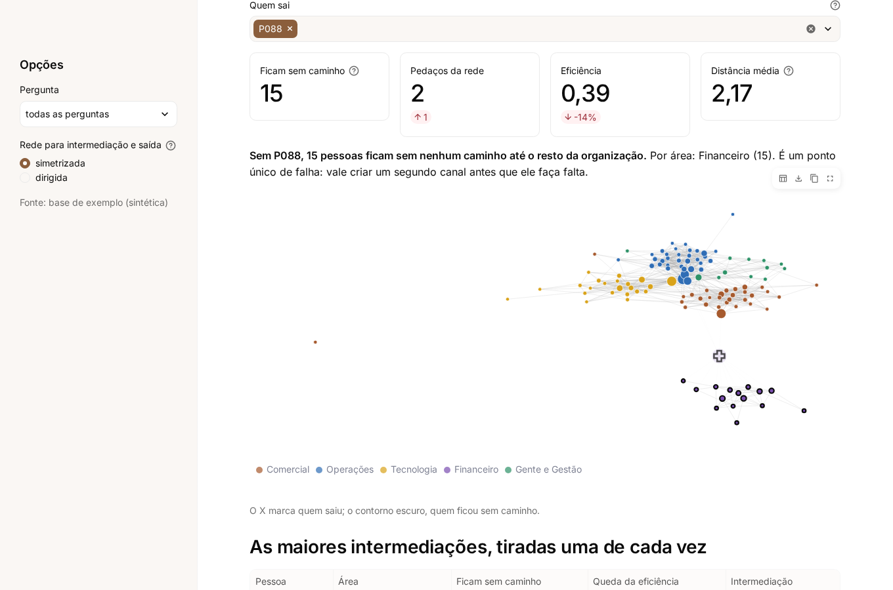
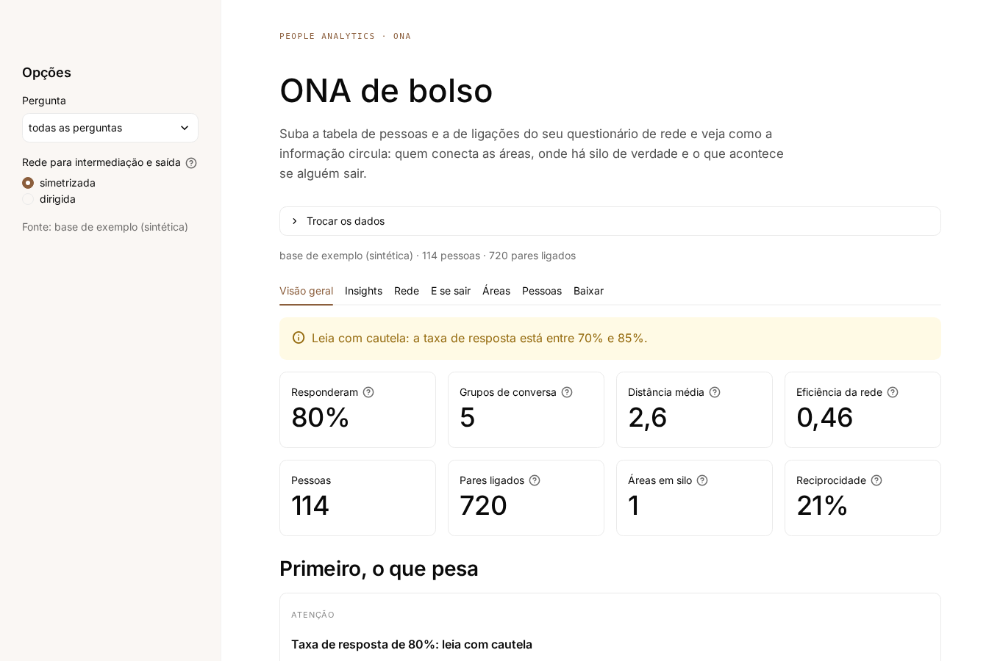
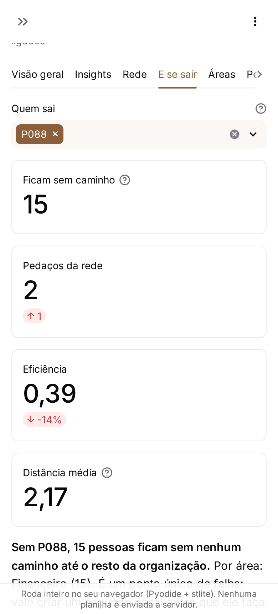

# ONA de bolso

Análise de rede organizacional (ONA) a partir de um questionário simples e duas planilhas.
Mostra quem conecta as áreas, onde há silo de verdade e o que acontece com a rede se uma pessoa sair.

É um pacote Python (pandas + networkx) com linha de comando, relatório HTML completo e um resumo de uma página para o gestor, um notebook que conta a análise passo a passo e um app Streamlit. O mesmo app roda no navegador, sem servidor, na [demonstração do site](https://gleissonbispo.com.br/projetos/ona-de-bolso/demo).

**Quer só o questionário?** As perguntas, como aplicar e os modelos de planilha estão em [`questionario/questionario-ona.md`](questionario/questionario-ona.md).



## O problema

O organograma diz quem responde a quem. Ele não diz por onde a informação passa. Quando um projeto trava entre duas áreas, ou quando sai uma pessoa e "de repente" ninguém mais sabe resolver nada, quase sempre o motivo está na rede informal.

ONA (Organizational Network Analysis) mede essa rede. As ferramentas comerciais custam caro e pedem integração com e-mail e agenda. Para a maior parte das perguntas de um gestor, basta um questionário de nomeação de 2 a 4 perguntas, como "com quem você trocou informação importante nas últimas 4 semanas?".

| Pergunta de gestor | Como a análise responde |
|---|---|
| A rede depende de alguém? | Tira, uma de cada vez, as 10 pessoas com maior intermediação e mede quem perde o caminho até o resto e quanto cai a eficiência da rede |
| Que área virou silo? | Índice E-I de cada área comparado com o esperado ao acaso. Só é silo a área muito abaixo do acaso, não toda área que conversa mais com o próprio time |
| Por onde a informação entra e sai de cada área? | Papéis de corretagem de Gould e Fernandez: porteiro, representante, consultor, ligação e coordenador |
| Quem conecta grupos que não se falam? | Intermediação e restrição de Burt (buracos estruturais) |
| Os grupos reais batem com o organograma? | Comunidades (Louvain, 20 execuções, com checagem de estabilidade) cruzadas com as áreas |
| O gestor está no fluxo do time? | Fração do time com ligação direta com o gestor |
| Dá para confiar no resultado? | Taxa de resposta, simulação de mais não resposta e regra de leitura: abaixo de 70% de resposta, a análise não conclui sobre pontes e isolados |

## Instalação

Python 3.11 ou mais novo. Com [uv](https://docs.astral.sh/uv/):

```bash
git clone https://github.com/gleissonbispo/ona-de-bolso.git
cd ona-de-bolso
uv sync                       # pacote + ferramentas de desenvolvimento (pytest, ruff, streamlit, matplotlib)
uv run ona-de-bolso --help
```

Com pip:

```bash
python -m venv .venv && source .venv/bin/activate
pip install -e ".[app]"       # só o pacote: pip install -e .
```

O núcleo depende só de pandas, numpy e networkx. O app acrescenta Streamlit e Altair; o notebook, matplotlib.

## Como usar

**As duas tabelas.** `pessoas.csv` (quem foi convidado: `id`, `area`, `cargo`, `gestor_id`, `unidade`, `respondeu`) e `ligacoes.csv` (quem citou quem: `origem_id`, `destino_id`, `tipo`, `peso`). Também vale um `.xlsx` com as duas abas. Modelos em `questionario/modelo-ona.xlsx`, `questionario/modelo-pessoas.csv` e `questionario/modelo-ligacoes.csv`.

**Linha de comando.** Gera um relatório HTML num arquivo só, que abre sem internet e pode ir por e-mail. A tabela por pessoa fica fora, a não ser que você peça. Com `--gestor`, grava também o resumo de uma página: a resposta às três perguntas (área em silo, dependência de uma pessoa, gestor no fluxo do time), os achados principais, o que fazer e os limites.

```bash
ona-de-bolso analisar pessoas.csv ligacoes.csv --saida relatorio.html --gestor resumo.html --csv metricas.csv
ona-de-bolso analisar pesquisa.xlsx --saida relatorio.html      # Excel com as duas abas
ona-de-bolso exemplo dados/                                     # copia a base de exemplo
```

**Em Python.**

```python
import ona_de_bolso as ona

pessoas, ligacoes = ona.ler_pessoas_ligacoes("pessoas.csv", "ligacoes.csv")
r = ona.analisar(pessoas, ligacoes)            # dicionário com métricas, áreas, riscos e insights
r["insights"][0]["titulo"]
r.pessoas_df()                                 # métricas por pessoa em DataFrame
ona.simular_saida(r, ["P088"])                 # e se essa pessoa sair?
```

**Notebook.** [`notebooks/analise-ona.ipynb`](notebooks/analise-ona.ipynb) conta a análise da base de exemplo do começo ao fim: pergunta de negócio, dados, rede, métricas, insights e limites. As saídas estão salvas, então dá para ler direto no GitHub.

**App Streamlit.**

```bash
uv run streamlit run app/app.py
```

Suba as duas planilhas (ou o Excel) ou use a base de exemplo. O app tem visão geral, insights, a rede interativa, a simulação "e se sair", as áreas, a tabela por pessoa (escondida por padrão) e o download do resumo para o gestor, do relatório completo e do CSV de métricas. Na rede, a roda do mouse aproxima, arrastar move e dois cliques voltam ao desenho inteiro; passar o mouse numa pessoa mostra área, cargo e papel e destaca quem está ligado a ela; o clique fixa o destaque e abre o painel da pessoa, com o botão "Simular a saída". Dá para filtrar as áreas e colorir por área, comunidade ou papel.

<p>


</p>

**No navegador, sem instalar nada.** A demonstração do site roda o mesmo `app/app.py` e o mesmo pacote com [stlite](https://github.com/whitphx/stlite), que leva o Python (Pyodide) para dentro do navegador. Nenhuma planilha sai do computador de quem usa. Para gerar a página: `python scripts/montar_demo.py` (grava `demo/index.html`, com o app e a base de exemplo embutidos e o `@stlite/browser` 1.12.2 fixo pelo jsDelivr). Na primeira visita o navegador baixa cerca de 30 MB e o app abre em uns 25 s; depois fica em cache.

## Do Google Forms ou Microsoft Forms às duas tabelas

O questionário completo (as perguntas por extenso, como escrever, quem convidar, taxa de resposta, texto de convite e cuidados de LGPD) está em [`questionario/questionario-ona.md`](questionario/questionario-ona.md).

1. **Monte a tabela de pessoas antes do formulário.** Uma linha por pessoa convidada, com um código no lugar do nome (`A001`, `A002`...), a área, o gestor e a unidade. Ela vem do cadastro do RH, não do formulário.
2. **Crie o formulário.** Primeira pergunta: "Seu código" (lista suspensa com os códigos ou nomes acompanhados do código). Depois, uma pergunta de caixas de seleção para cada tipo de ligação (`informacao`, `ajuda`...). Em cada opção, coloque o nome e o código entre parênteses: `Ana Souza (A002)`. Com muitas pessoas, divida as opções por área em seções.
   - Google Forms: tipo "Caixas de seleção"; em "Validação de resposta", limite a "No máximo 10".
   - Microsoft Forms: tipo "Escolha" com "Várias respostas" ligado.
3. **Exporte as respostas.** Google Forms: aba Respostas, "Link para o Planilhas", depois Arquivo > Fazer download > CSV. Microsoft Forms: Respostas, "Abrir no Excel" (baixa um `.xlsx`).
4. **Converta para a tabela de ligações.** O conversor acha os códigos dentro das respostas, aceita vírgula (Google) e ponto e vírgula (Microsoft) e marca quem respondeu:

```bash
ona-de-bolso converter-forms respostas.csv --pessoas pessoas.csv \
    --quem "Seu código" \
    --pergunta informacao="Nas últimas 4 semanas, com quem" \
    --pergunta ajuda="Quando você trava" \
    --saida ligacoes.csv --marcar-respondeu pessoas.csv
```

   O texto depois de `=` é o começo do título da coluna no arquivo exportado. Funciona com `.csv` e `.xlsx`.
5. **Rode a análise** no app, na linha de comando ou no notebook.

Quem preferir pode montar `ligacoes.csv` à mão numa planilha: uma linha por nome citado, com `origem_id` (quem respondeu), `destino_id` (quem foi citado), `tipo` (a pergunta) e `peso` (frequência de 1 a 5, opcional).

## Métodos

O pacote fica em `ona_de_bolso/`: `io` (leitura de CSV e XLSX, validação, conversor de Forms), `metricas` (o método), `insights` (regra de leitura e textos), `relatorio` (HTML) e `cli`. O networkx resolve intermediação, Louvain, modularidade, k-core e o layout do desenho. O resto foi escrito para o projeto e tem teste: E-I com linha de base, papéis de Gould e Fernandez, separação de comunidades desconectadas, Rand ajustado, "e se sair", sensibilidade e regra de leitura. Restrição de Burt e eficiência global seguem exatamente a fórmula do networkx (os testes comparam), reescritas porque a versão do networkx levava 2,6 s na base de exemplo (1,3 s cada), mais que a análise inteira de hoje.

- **Duas redes.** Citações recebidas, reciprocidade e papéis de corretagem usam a rede dirigida (quem cita quem). Intermediação, comunidades, E-I, restrição de Burt e a simulação de saída usam a rede simetrizada: há ligação se um dos dois citou o outro. Informação corre nos dois sentidos, e quem não respondeu (que não cita ninguém) continua podendo aparecer como ponte. Na base de exemplo, a pessoa P105 não respondeu e é citada por quatro áreas: na rede dirigida a intermediação dela é zero; na simetrizada, ela é a 7ª maior.
- **Intermediação:** algoritmo de Brandes (2001), normalizada de 0 a 1.
- **Comunidades:** Louvain (Blondel et al., 2008) rodado 20 vezes com sementes diferentes. Fica a divisão de maior modularidade. Depois, toda comunidade com pedaços sem ligação entre si é separada, a garantia mínima que motivou o algoritmo Leiden (Traag, Waltman e van Eck, 2019); separar nunca reduz a modularidade. A estabilidade é o índice de Rand ajustado (Hubert e Arabie, 1985) médio entre a divisão escolhida e as outras execuções.
- **Índice E-I com linha de base:** E-I de Krackhardt e Stern (1988) por área, comparado com o E-I esperado ao embaralhar as áreas entre as pessoas 1.000 vezes, mantendo o tamanho de cada área e a rede. Silo = E-I abaixo do esperado com p < 0,01 e menos de 25% das ligações externas que a área teria ao acaso.
- **Papéis de corretagem:** Gould e Fernandez (1989), com a área como grupo. A informação corre de quem é citado para quem cita ("busco informação com").
- **Restrição e tamanho efetivo:** Burt (1992; 2004), na rede simetrizada com pesos.
- **E se sair:** remove a pessoa e mede componentes, quem perde o caminho até a maior parte da rede e a eficiência global (Latora e Marchiori, 2001).
- **Sensibilidade à não resposta:** compara a rede dirigida com a simetrizada e repete as contas apagando as citações de mais 10% de quem respondeu (20 sorteios), na linha de Borgatti, Carley e Krackhardt (2006) e Kossinets (2006).
- **Núcleo:** k-core (Seidman, 1983), como leitura simples de núcleo e periferia.
- **Reprodutível:** sorteios com o gerador mulberry32 e semente fixa. O mesmo arquivo dá sempre o mesmo resultado, e há teste para isso.

Leitura de fundo para quem vai usar com gestores: Cross e Parker (2004).

## Resultado na base de exemplo

A base de exemplo é uma organização fictícia de 114 pessoas em 5 áreas, gerada por `scripts/gerar_base.py` com semente fixa. O gerador planta o que os testes conferem:

| Plantado | O que a análise achou |
|---|---|
| Financeiro em silo, ligado ao resto por uma pessoa (P088) | Financeiro é a única área em silo: E-I de -0,89 contra +0,86 esperado ao acaso (6% das ligações externas esperadas). As outras quatro também conversam mais para dentro do que o acaso, mas ficam entre 28% e 68% |
| P088 como porteiro: busca informação fora e repassa ao time | Papel de porteiro, responsável por 100% das entradas de informação no Financeiro |
| P088 como ponto único de falha | Sem P088, 15 pessoas ficam sem caminho até o resto da rede e a eficiência cai 14% |
| Duas pontes (P036 e P069) | Entre as 5 maiores intermediações e com as duas menores restrições de Burt entre quem tem 4 ligações ou mais (0,065 e 0,066) |
| Uma ponte que não respondeu (P105) | Intermediação zero na rede dirigida e 7ª maior na simetrizada |
| Gestor do Comercial fora do fluxo | 0 de 29 pessoas do time ligadas a ele |
| 3 isolados e 20% de não resposta | Os 3 aparecem; taxa de 80% gera o aviso "leia com cautela" |

Comunidades: 5 grupos, modularidade 0,54, concordância de 0,90 entre as 20 execuções. Na simulação com mais 10% de não resposta, 87% das cinco maiores pontes continuam no topo e o silo se repete em todos os sorteios. A análise completa, com 1.000 permutações e 20 sorteios, leva 1,6 s no Raspberry Pi 5.

## Testes

```bash
uv run pytest            # 74 testes
uv run ruff check .
```

- `testes/test_algoritmos.py`: cada algoritmo numa rede pequena com resposta conhecida (caminho, estrela, duas panelinhas, grafo completo, os cinco papéis de Gould e Fernandez, Burt na estrela e no triângulo).
- `testes/test_base_exemplo.py`: o que foi plantado na base sintética tem de aparecer, mais a regra de leitura (abaixo de 70% some o insight de pontes) e o anonimato (área com menos de 5 pessoas não aparece).
- `testes/test_paridade_js.py`: compara com o motor JavaScript da versão anterior (tag `v1-javascript`), na base de exemplo. O Python usa o mesmo gerador e as mesmas regras, então intermediação, E-I, p-valores, papéis, Burt, "e se sair", sensibilidade e textos dos insights batem número a número. Só o Louvain do networkx é outro algoritmo: aí a comparação é da modularidade (0,5401 nas duas versões) com tolerância e da estabilidade (0,90 contra 0,91).
- `testes/test_io.py`, `testes/test_cli.py` (inclui o resumo para o gestor) e `testes/test_app.py` (o app abre, roda a base de exemplo e o botão "Simular a saída" muda a simulação).

Os testes e o lint rodam a cada push no GitHub Actions.

## Estrutura

```
ona_de_bolso/   o pacote: io, metricas, insights, relatorio, cli e a base de exemplo
app/            app Streamlit (o mesmo arquivo roda no navegador com stlite)
notebooks/      a análise passo a passo, com as saídas salvas
demo/           página da demonstração no navegador (gerada por scripts/montar_demo.py)
scripts/        gerador da base sintética, montagem da demo e do notebook
questionario/   texto do questionário, cuidados de LGPD e modelos de planilha
testes/         pytest, referência do motor JS e respostas de Forms para teste
docs/           documento do projeto e histórico
```

A versão anterior, com o motor em JavaScript e a página que abria com duplo clique, está na tag [`v1-javascript`](https://github.com/gleissonbispo/ona-de-bolso/tree/v1-javascript).

## Limitações

- Questionário de nomeação mede a percepção de quem responde, num momento. Não é registro de interação.
- Não resposta fura a rede justamente nas ligações que faltam. A rede simetrizada recupera parte (quem é citado aparece), mas ligações entre duas pessoas que não responderam não existem na base. Por isso a regra dos 70%.
- Os papéis de corretagem dependem do sentido da citação e, portanto, de quem respondeu. Quem não respondeu não aparece como porteiro nem como representante.
- O limiar de silo (25% das ligações externas esperadas) é uma escolha de leitura. Ele está fixo no código e documentado, mas não é um valor universal.
- O refinamento de comunidades separa pedaços desconectados, mas não é o algoritmo Leiden completo.
- O desenho da rede usa o layout de força do networkx e fica limitado a 499 pessoas. Acima disso, o app mostra só as métricas.
- Na demonstração no navegador, a primeira carga baixa cerca de 30 MB (Python, Streamlit, pandas, networkx) e a análise da base de exemplo leva uns 9 s, contra 1,6 s no Python do Raspberry Pi 5.
- Pesos (frequência de 1 a 5) entram nas comunidades e na restrição de Burt. Intermediação e distâncias ignoram o peso.

## Ética e LGPD

- **Finalidade e transparência.** O convite diz para que serve a pesquisa e o que não vai acontecer com as respostas. Alinhe base legal, finalidade, prazo de guarda e quem vê o resultado com o jurídico e o encarregado de dados (DPO) antes de enviar.
- **Consentimento informado e participação voluntária.** Ninguém deve ser cobrado individualmente por não responder.
- **Uso agregado.** Resultados por área só aparecem com 5 pessoas ou mais. A tabela por pessoa fica escondida por padrão.
- **Diagnóstico de rede, não avaliação de pessoa.** Intermediação alta não é desempenho alto; isolamento não é problema de comportamento. Nenhuma métrica daqui deve entrar em avaliação, promoção ou desligamento.
- **Pseudonimização.** Use códigos no lugar de nomes. O app, a linha de comando e a demonstração no navegador calculam tudo localmente; nenhuma planilha vai para servidor.

## O que aprendi

- **Quem não respondeu some da rede dirigida.** Na primeira versão, uma pessoa citada por quatro áreas aparecia com intermediação zero só porque não tinha preenchido o questionário. Passei a usar a rede simetrizada para as medidas de fluxo, e isso virou teste.
- **Sem linha de base, toda área parece silo.** As cinco áreas da base de exemplo conversam mais para dentro do que o acaso daria. Comparando com o esperado, só uma fica fora do padrão: 6% das ligações externas esperadas, contra 28% a 68% das outras.
- **Louvain não dá sempre a mesma resposta.** Rodo 20 vezes e mostro a concordância entre as execuções. É mais honesto do que apresentar uma divisão como se fosse a única.
- **Teste de paridade separa método de implementação.** Ao trazer o motor de JavaScript para Python, usei o mesmo gerador pseudoaleatório nas duas versões, e as 1.000 permutações do E-I bateram até a última casa. A diferença que sobrou é só o Louvain, e ela tem explicação.
- **Biblioteca pronta nem sempre é a melhor escolha.** A restrição de Burt do networkx dava o mesmo número que a minha conta, mas era mais lenta que a análise inteira. Mantive a fórmula, reescrevi a conta e deixei o networkx como gabarito no teste.
- **Gestor pergunta "e se ela sair?", não "quem é a ponte?".** Medir a saída (15 pessoas sem caminho, eficiência 14% menor) transforma uma métrica abstrata num risco que dá para discutir em reunião. Foi daí que saiu o resumo de uma página.

## Referências

- Blondel, V. D., Guillaume, J.-L., Lambiotte, R., & Lefebvre, E. (2008). Fast unfolding of communities in large networks. *Journal of Statistical Mechanics*, P10008.
- Borgatti, S. P., Carley, K. M., & Krackhardt, D. (2006). On the robustness of centrality measures under conditions of imperfect data. *Social Networks*, 28(2), 124–136.
- Brandes, U. (2001). A faster algorithm for betweenness centrality. *Journal of Mathematical Sociology*, 25(2), 163–177.
- Burt, R. S. (1992). *Structural Holes: The Social Structure of Competition*. Harvard University Press.
- Burt, R. S. (2004). Structural holes and good ideas. *American Journal of Sociology*, 110(2), 349–399.
- Cross, R., & Parker, A. (2004). *The Hidden Power of Social Networks*. Harvard Business School Press.
- Gould, R. V., & Fernandez, R. M. (1989). Structures of mediation: A formal approach to brokerage in transaction networks. *Sociological Methodology*, 19, 89–126.
- Hubert, L., & Arabie, P. (1985). Comparing partitions. *Journal of Classification*, 2, 193–218.
- Kossinets, G. (2006). Effects of missing data in social networks. *Social Networks*, 28(3), 247–268.
- Krackhardt, D., & Stern, R. N. (1988). Informal networks and organizational crises: An experimental simulation. *Social Psychology Quarterly*, 51(2), 123–140.
- Latora, V., & Marchiori, M. (2001). Efficient behavior of small-world networks. *Physical Review Letters*, 87(19), 198701.
- Seidman, S. B. (1983). Network structure and minimum degree. *Social Networks*, 5(3), 269–287.
- Traag, V. A., Waltman, L., & van Eck, N. J. (2019). From Louvain to Leiden: guaranteeing well-connected communities. *Scientific Reports*, 9, 5233.

## Licença

MIT. Veja [LICENSE](LICENSE). Os dados de exemplo são sintéticos; nenhum dado de empregador foi usado.

## Autor

**Gleisson Bispo**, Gerente de People Analytics. Escrevo sobre dados de pessoas, Data Science e IA aplicada a RH.

- Site: [gleissonbispo.com.br](https://gleissonbispo.com.br) (projetos, artigos, radar de notícias e vagas de People Analytics)
- LinkedIn: [linkedin.com/in/gleissonbispo](https://www.linkedin.com/in/gleissonbispo)
- Newsletter: [People Analytics LAB](https://www.linkedin.com/newsletters/people-analytics-lab-7423156507271368704), no LinkedIn
- GitHub: [@gleissonbispo](https://github.com/gleissonbispo)
